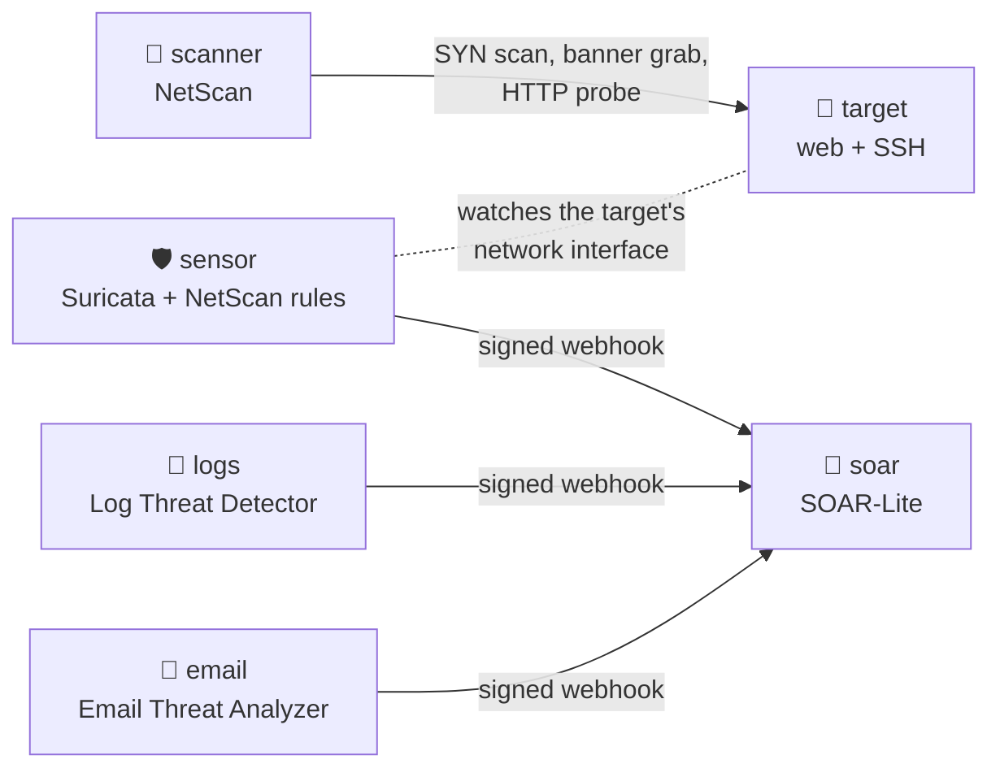

# SOC Lab

[](https://github.com/AhmedDAH1/soc-lab/actions/workflows/ci.yml)

One command runs an attack, detects it and turns it into an incident, using
four tools I built, each at its published release:

```bash
./lab.sh
```


## What happens



1. **SOAR-Lite** starts with a fresh webhook secret that `lab.sh` generates.
2. **The target** runs a web server announcing Apache 2.4.49 and an SSH
   service announcing OpenSSH 7.4p1. It's a decoy; nothing is actually
   vulnerable.
3. **The sensor** runs Suricata inside the target's network namespace, so it
   sees every packet the target sends and receives, with NetScan's
   [detection rules](https://github.com/AhmedDAH1/network-scanner/tree/main/detections).
4. **NetScan** scans ports 1-100 on the target, reads the banners, matches
   both versions to known CVEs and sends an HTTP probe.
5. Suricata fires two rules: Scapy's default SYN packet (sid 1000001) and
   NetScan's User-Agent (sid 1000002). The sensor signs each alert with
   HMAC-SHA256 and sends it to SOAR-Lite.
6. **Log Threat Detector** and **Email Threat Analyzer** analyse their bundled
   sample data (SSH brute force, a port scan, a phishing email) and send their
   findings the same way.
7. In SOAR-Lite each alert becomes an incident, with its IP addresses,
   domains and hashes extracted as indicators. The scanner's address,
   `172.28.0.20`, is on the NetScan incidents.

`lab.sh` waits until every expected incident has arrived and prints the
result:

```
  ✓ NetScan caught by Suricata: packet fingerprint   incident #10
  ✓ NetScan caught by Suricata: HTTP probe           incident #11
  ✓ Log Threat Detector: SSH brute force             incident #2
  ✓ Email Threat Analyzer: phishing verdict          incident #1
  ✓ Scanner address 172.28.0.20 extracted as an IOC

11 incidents in SOAR-Lite.
```

Then open the dashboard at http://localhost:8000.

## Requirements

- Docker with Docker Compose (Docker Desktop on macOS and Windows).
- `python3` on your machine, for `lab.sh` and `verify.py` (standard library
  only).
- Internet access to Docker Hub (base images) and GitHub (each project is
  built from its release tag). The first build takes a few minutes.

## Commands

```bash
./lab.sh                          # build, start, wait for every incident
docker compose logs scanner       # NetScan's scan output
docker compose logs sensor        # Suricata alerts and their forwarding
docker compose up scanner         # scan again; Suricata alerts once a minute per source
docker compose down               # stop everything (incidents are discarded)
```

## The projects

| Service | Project | Release | Role |
|---|---|---|---|
| `scanner` | [network-scanner](https://github.com/AhmedDAH1/network-scanner) | v2.3.0 | Attacker: SYN scan, banners, CVE matching |
| `sensor` | network-scanner's [detections](https://github.com/AhmedDAH1/network-scanner/tree/main/detections) | v2.3.0 | Suricata rules and the alert forwarder |
| `logs` | [log_threat_detector](https://github.com/AhmedDAH1/log_threat_detector) | v1.2.0 | Brute force and port scans in logs |
| `email` | [email-threat-analyzer](https://github.com/AhmedDAH1/email-threat-analyzer) | v1.2.0 | Phishing verdicts |
| `soar` | [soar-lite](https://github.com/AhmedDAH1/soar-lite) | v2.0.0 | Incidents, IOCs, enrichment, playbooks |

The same Sigma rules, with their test data, are in
[sigma-detection-rules](https://github.com/AhmedDAH1/sigma-detection-rules).

## Security

- Every alert is signed with a secret generated on first run and stored in
  `.env` (git-ignored). SOAR-Lite refuses unsigned or tampered alerts.
- Everything runs on an isolated Docker network. Only the dashboard is
  published, on `127.0.0.1:8000`.
- The scanner and sensor get only the Linux capabilities raw packets need
  (`NET_RAW`, `NET_ADMIN`), never `--privileged`.
- The scanner targets only the lab's own decoy container.

## Testing

CI runs `./lab.sh` on every push and once a week, and fails unless every
incident above arrives. It catches a change in any of the four projects that
breaks the pipeline.

## Troubleshooting

- **`WEBHOOK_SECRET` is not set:** run `./lab.sh` rather than
  `docker compose up` the first time; it creates `.env`.
- **Images won't download (for example in mainland China, where Docker Hub
  is blocked):** use a VPN or configure a registry mirror in Docker
  Desktop under Settings → Docker Engine (`"registry-mirrors"`).
- **A NetScan incident is missing:** `docker compose logs sensor` shows
  whether Suricata saw the scan and whether SOAR-Lite accepted the alert.

## License

MIT, see [LICENSE](LICENSE).
